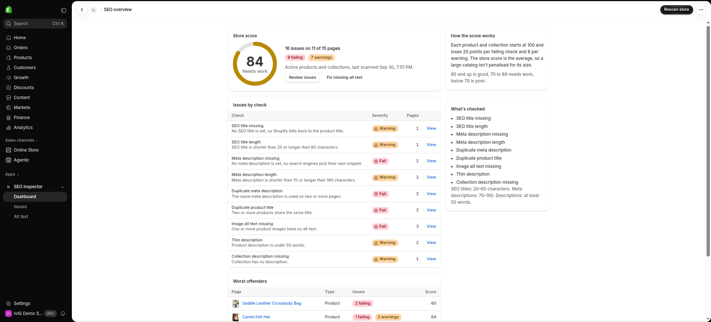
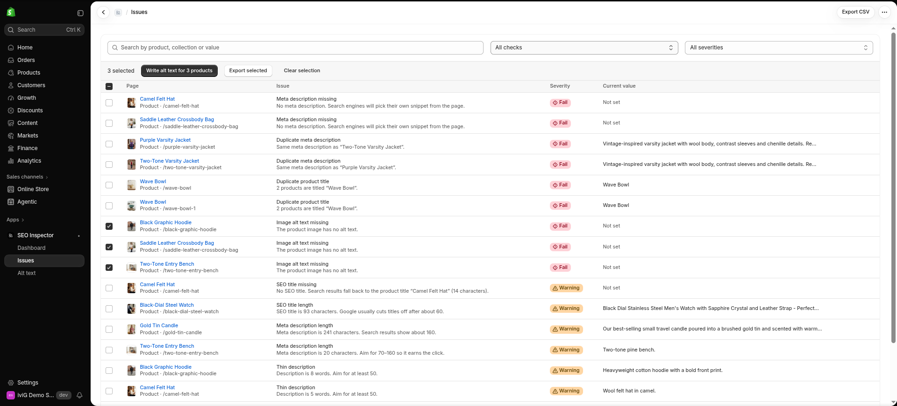
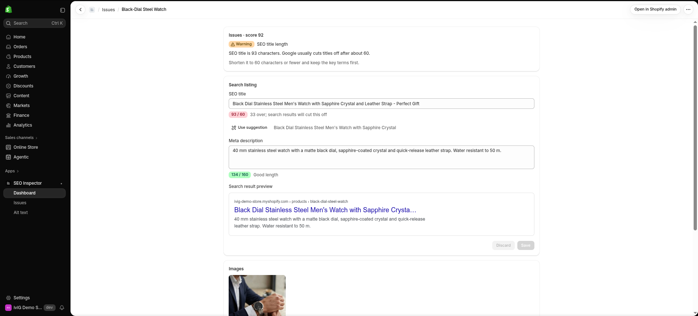
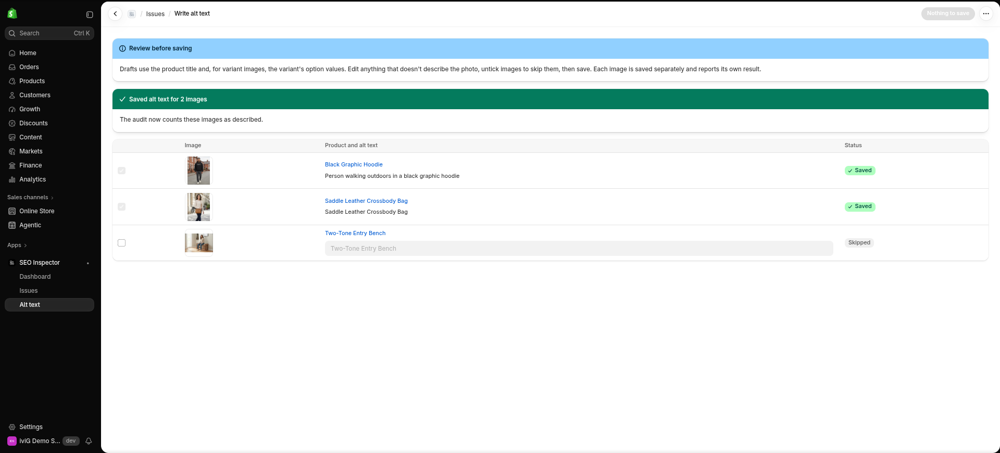

# SEO Inspector for Shopify

An embedded Shopify admin app that audits a store's products and collections for on-page SEO problems and lets the merchant fix them in place. It scores the store from 0 to 100, lists every issue with the measured value and a suggested fix, and writes changes back through the Admin GraphQL API, reporting success or failure for every item.

It's the Shopify sibling of TechSEO Inspector (Chrome extension) and [Sitemap Scout](https://github.com/MilanG-Ne/sitemap-scout).

**[Watch the 78-second demo](docs/seo-inspector-demo.mp4)**: audit a store, bulk-write alt text, fix an overlong SEO title, and watch the score go from 84 to 87. It was recorded against a development store seeded with deliberate SEO problems.

| Dashboard | Issues |
|---|---|
|  |  |
| **Fix form** | **Bulk alt text** |
|  |  |

## What it checks

Nine checks across active products and collections. Each issue records the resource, the check, a severity, the current value and a suggested fix.

| Check | Rule | Severity |
|---|---|---|
| SEO title missing | Product has no SEO title (Shopify falls back to the product title) | Warning |
| SEO title length | SEO title is under 20 or over 60 characters | Warning |
| Meta description missing | Product has no meta description | Fail |
| Meta description length | Meta description is under 70 or over 160 characters | Warning |
| Duplicate meta description | The same description is used on two or more products or collections | Fail |
| Duplicate product title | Two or more products share a title | Fail |
| Image alt text missing | One or more product images have no alt text (one issue per product, with a count) | Fail |
| Thin description | Product description is under 50 words | Warning |
| Collection description missing | Collection has no description | Warning |

Details that matter for accuracy:

- **Lengths are measured in characters (code points)**, and the live counters in the fix form use the same function as the audit. If a counter is green, the check passes.
- **Length checks only apply to values that are set.** An empty SEO title is reported once, as missing, rather than also as "too short" for the fallback title.
- **Duplicates are compared case- and whitespace-insensitively.** Empty values are never duplicates of each other.
- **Descriptions are measured as text**, not HTML: tags, scripts and entities are stripped before counting words.
- **Shopify's built-in "Home page" collection (`frontpage`) is skipped.** Every store has it and it isn't merchandised, so flagging it is noise.
- **Only active products are scanned.** Drafts and archived products aren't indexed.

### Score

Each product and collection starts at 100 and loses 20 points per failing check and 8 per warning, floored at 0. The store score is the average across all scanned pages, so a large catalog isn't penalised for its size. 90 and up is good, 70–89 needs work, below 70 is poor. The dashboard lists the lowest-scoring pages as "worst offenders".

## Fixing issues

Nothing is written without the merchant seeing it first, and every write reports its own result.

- **Search listing form** (per product or collection): edit the SEO title and meta description with live counters (green in range, amber when short, red when empty or over the limit) and a Google-style result preview. Where the app can derive a fix that passes the rule from the page's own copy, it offers **Use suggestion**. For example, it trims an overlong title at a separator or word boundary, or builds a meta description from the product description's first whole sentences. Products with a duplicate title also get a product title field.
- **Bulk alt text**: select issues in the table (or open the Alt text page) to draft alt text for every image that's missing it. Drafts use the product title plus, for variant images, the option values shared by the variants that use the image ("Varsity Jacket – Navy"). The merchant edits drafts or unticks images, then saves. Each image is saved with its own `fileUpdate` call and shows *Saved* or the exact error.
- **Descriptions** (thin product copy, empty collection intros) link straight to the resource in the Shopify admin, because writing copy is out of scope for v1.
- **Export CSV** of all, filtered or selected issues, with spreadsheet formula injection neutralised.

## How it's built

```
app/
  seo/            Pure audit engine: types, rules, text helpers, the nine checks,
                  scoring and alt text drafting. No Shopify or React imports.
  catalog/        Maps Admin GraphQL nodes onto the engine's model, fetches and
                  caches the catalog, and performs writes.
  shopify/        GraphQL operations, a typed request helper, and cost-based
                  throttling.
  routes/         Dashboard, issues table, resource detail, bulk alt text.
  components/     Score ring, SEO field with counter, search result preview.
  store.server.ts The one interface routes use to read and write store data.
test/             Vitest suites, including an answer key for the demo store.
```

- **React Router 7 + Shopify's app template**, rendering with **Polaris web components** (`<s-page>`, `<s-table>`, `<s-text-field>`, and so on) and App Bridge, so it looks native in the admin.
- **Admin GraphQL API 2026-07.** Every operation is a `#graphql` string in [`app/shopify/operations.ts`](app/shopify/operations.ts). `npm run graphql-codegen` generates variable and result types from them, and `AdminClient.request()` only accepts those generated operations, so API data is typed end to end with no `any`.
- **Rate limits.** Shopify rate-limits GraphQL by calculated query cost (a leaky bucket). The client reads `extensions.cost.throttleStatus` after every call, waits for the bucket to refill before the next request when it's short, and retries `THROTTLED` responses with backoff. Page sizes keep each query well under the 1,000-point single-query limit.
- **Pagination** uses cursors for products (25 per page, up to 25 images each) and collections (50 per page).
- **Caching.** The scanned catalog is cached per shop for two minutes, so moving between pages doesn't rescan. Writes patch the cached copy and **Rescan store** bypasses it.
- **Session storage** is the template default (Prisma + SQLite).

## Access scopes

| Scope | Why |
|---|---|
| `read_products` | Scan products, collections and product media. |
| `write_products` | Save SEO titles, meta descriptions and product titles (`productUpdate`, `collectionUpdate`). |
| `write_files` | Save image alt text. Shopify moved media alt text to `fileUpdate`, and `productUpdateMedia` no longer exists in 2026-07. |

`read_content` isn't requested: pages and blog posts aren't audited yet, so the app doesn't ask for access it doesn't use.

## Setup

Requirements: Node 22 (`.nvmrc`), the [Shopify CLI](https://shopify.dev/docs/apps/tools/cli), a Shopify Partner account and a development store.

```bash
npm install
npm run dev
```

`npm run dev` runs `shopify app dev`. The first time, the CLI asks you to log in and to create or link an app, which fills in `client_id` in `shopify.app.toml`. Then it sets up the database and a tunnel. Press **P** to open the app and install it on your development store.

### Preview mode (no Shopify account needed)

```bash
npm run preview:ui
```

This opens the full UI at <http://localhost:3000/app> against the bundled demo catalog ([`app/demo/demo-store.json`](app/demo/demo-store.json)), in memory. Fixes work and change the in-memory copy; **Reset demo data** restores it. Preview mode skips authentication, so the app refuses to start with it in a production build.

### Scripts

| Command | What it does |
|---|---|
| `npm test` | Unit tests (Vitest) |
| `npm run typecheck` | React Router type generation + `tsc` (strict) |
| `npm run lint` | ESLint |
| `npm run check` | All three |
| `npm run graphql-codegen` | Regenerate API types after editing `operations.ts` |

## Tests

Every check rule is a pure function with its own tests, including the boundary values (20/60 and 70/160 characters, 49/50 words). The same goes for text measurement, suggestion drafting, scoring, the GraphQL-to-model mapping, throttling and the retry loop, CSV export and request parsing.

The demo store suite runs the audit over real API responses captured from the seeded development store. It asserts that the app finds exactly the 16 seeded issues and nothing else: two clean control products, two complete collections, and the built-in Home page collection all stay unflagged. It also checks the measured values from the seed notes (a 93-character title, a 241-character meta description, 8- and 5-word descriptions) and the score of 84.

## Limitations

- **Live scan, capped at 2,500 active products.** Scanning is fast for typical catalogs, but very large stores would need Bulk Operations and a stored snapshot. The dashboard says so when a scan is cut short.
- **The first 25 images per product** are checked for alt text.
- **Character limits are a proxy.** Google truncates titles and snippets by pixel width, and themes usually append the store name to the title tag.
- **The catalog cache lives in process memory.** A multi-instance deployment should move it to a shared store.
- **Alt text drafts are templated, not visual.** They describe the product, not what the photo shows, which is why every draft is reviewed before saving.
- **SEO title and meta description checks cover products.** Collections are checked for a description and included in duplicate detection. Their SEO fields can be edited in the app, but empty collection SEO fields aren't flagged in v1.
- The mandatory GDPR webhooks for public App Store apps aren't implemented, because this isn't listed on the App Store. The app stores no customer data.

## Next

- Theme and structured data (JSON-LD) analysis
- Pages and blog posts (would add `read_content`)
- AI-written descriptions and image-aware alt text
- Bulk "apply suggestions" for SEO fields
- Bulk Operations for large catalogs, and scheduled scans with history
- Billing and an App Store listing

## License

[MIT](LICENSE.md)
